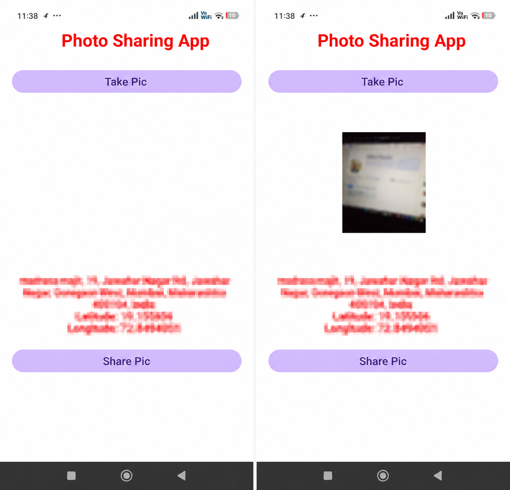

# Photo Location Share

An Android application built using Java and Android Studio to capture photos, retrieve location information, and share photos with location details.

## Features

- Capture photos using the device camera
- Retrieve device location using Google Play Services Location
- Display location coordinates and address information
- Share photos using Android's sharing functionality

## Technologies Used

- Java
- Android Studio
- XML
- Android SDK
- Google Play Services Location
- Android FileProvider

## Project Status

Currently under development. Features and functionality are subject to testing and improvement.

## How to Run

1. Download or clone this repository.
2. Open the project in Android Studio.
3. Allow Gradle to sync.
4. Connect an Android device or start an emulator.
5. Build and run the application.

## App Screenshots

### Home Screen

## Author

Soham Murkar
